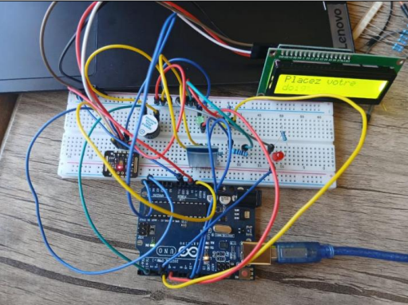

# Heart Rate Monitoring and Anomaly Detection System _ HeartNova

## Overview

This project focuses on developing an embedded system for real-time heart rate and blood oxygen saturation (SpO₂) monitoring. Built around an Arduino UNO and a MAX30102 optical sensor, the system measures vital signs and identifies abnormal values using predefined thresholds.

## Features

- **Heart Rate Monitoring:** Measures heart rate in beats per minute (BPM).
- **SpO₂ Monitoring:** Estimates blood oxygen saturation.
- **Real-Time Display:** Displays measurements and system status on a 16×2 LCD.
- **Bluetooth Communication:** Transmits data wirelessly using the HC-05 module.
- **Alert System:** Uses a red LED and a buzzer to indicate detected abnormal values.

## Hardware Components

- Arduino UNO
- MAX30102 heart rate and SpO₂ sensor
- 16×2 LCD with I²C interface
- HC-05 Bluetooth module
- Red LED
- Active buzzer
- Connecting wires and supporting electronic components

## Software and Technologies

- Arduino IDE
- Embedded C/C++ for Arduino
- I²C communication
- UART serial communication
- MAX30102 sensor library
- LCD and Bluetooth libraries

## How It Works

The MAX30102 sensor collects optical signals used to estimate heart rate and blood oxygen saturation. The Arduino UNO processes the measurements and compares them with predefined thresholds. Results are displayed on the LCD and transmitted through Bluetooth. When an abnormal value is detected, the LED and buzzer provide a visual and audible alert.

## Project Objective

The objective is to develop an accessible embedded prototype for vital-sign monitoring and basic anomaly alerts, illustrating the application of electronics and microcontroller programming in biomedical engineering.

Results 

The developed prototype integrates the main components of HeartNova, including the Arduino UNO, MAX30102 sensor, LCD display, Bluetooth module, LED, and buzzer. It demonstrates real-time monitoring of heart rate and SpO₂, wireless data transmission, and visual and audible alerts when abnormal values are detected.

Figure: Physical prototype of the HeartNova heart rate monitoring and anomaly detection system.

## Important Note

This prototype is intended for educational and experimental purposes. It is not a certified medical device and must not be used as a substitute for professional medical assessment.

Contributors

This project was developed collaboratively as part of a second-semester engineering project in Biomedical Engineering at INTeK, University of Jendouba, during the 2024–2025 academic year.

Team members:

Sirine Melki

Abir Ounifi

Farah Maghraoui

Emna Louati

Supervisor: Dr. Hiba Helali

